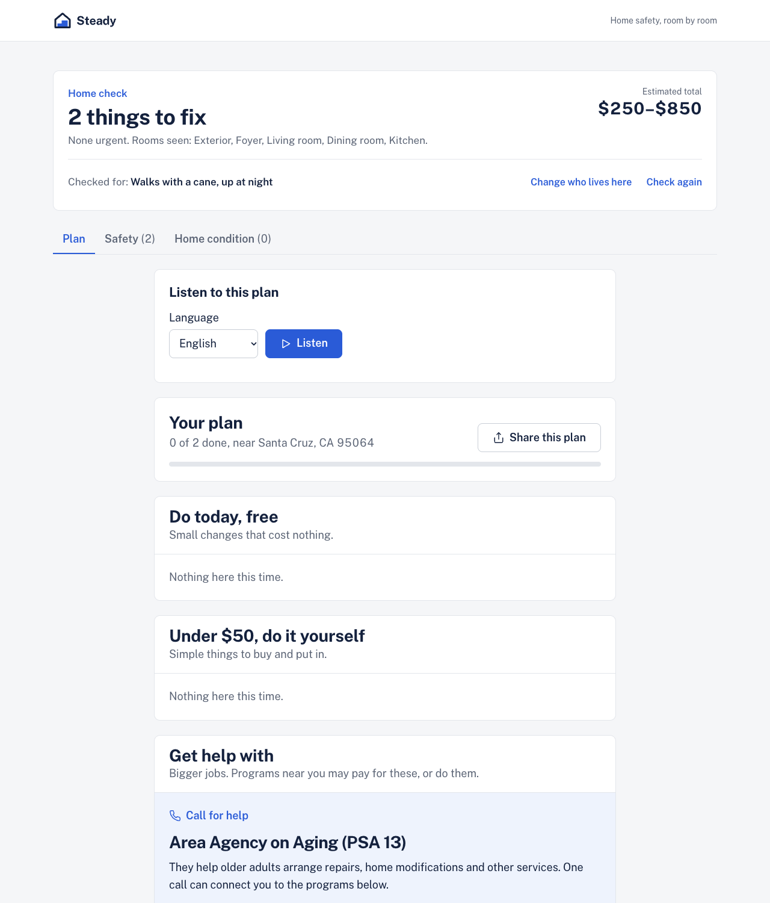
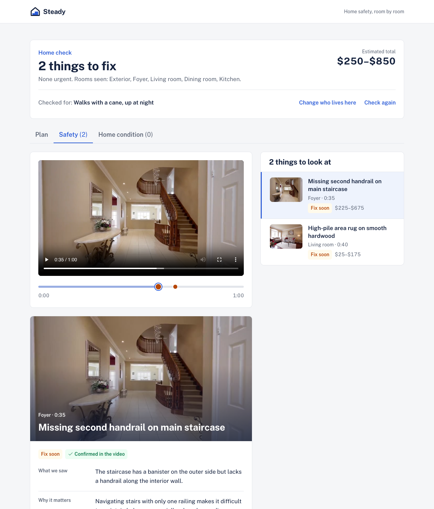

<p></p>

Film your home. Steady finds fall hazards, explains each fix and what it costs, and shows who can
help pay. Built for DevFest Santa Cruz 2026.

## The problem

Older adults often can't afford home repairs, and figuring out what to fix, who to call and how to
pay is overwhelming. Steady turns one video into **one simple plan**:

1. **Do today, free:** move the cord, clear the path.
2. **Under $50, do it yourself:** a price range and store links.
3. **Get help with:** bigger jobs, each paired with a verified local program that can help pay (or do
   the work), a nearby business, and one "Call for help" number for the local Area Agency on Aging.

The plan can be read aloud in English, Spanish, Vietnamese, Chinese, Tagalog or Korean, and shared
with family as a read-only link.

| Simple plan | Report |
|---|---|
|  |  |

## How verification works

Every finding has to survive three checks before it is shown:

1. **Evidence.** Gemini watches the video and must describe what it actually sees for each finding
   (`evidence`), with a timestamp and a confidence. Findings with no evidence or confidence below 0.5
   are dropped; anything below 0.75 is shown only under "less certain".
2. **Second pass.** A separate Gemini request re-watches the video and must confirm each finding is
   visible where claimed. Unconfirmed findings are removed. If this pass can't run, findings are marked
   "not double-checked".
3. **Frame check.** For uploads, real frames around each timestamp are pulled with ffmpeg and checked
   as images. The frame that shows the problem becomes the frame on screen, so people can judge it
   themselves.

Prices, products and assistance programs come from Google Search grounding. A link is kept only if it
matches a search result or a live page check passes (a 404 means it was invented). Program phone
numbers and "free" claims are kept only if the program's own page shows them.

We haven't run the labelled eval (`npm run eval`) on a full set of staged walkthroughs yet, so there
are no accuracy numbers here.

## Google services used

| Service | What it does in Steady |
|---|---|
| Gemini video understanding + structured output (Vertex AI) | Finds hazards with timestamps and evidence; responses are schema-constrained and validated with Zod |
| Gemini multi-pass verification | A second, independent pass must confirm each finding in the video |
| Gemini frame-level image checks | Frames around each timestamp are checked so the frame shown is the one that proves the finding |
| Grounding with Google Search | Price ranges, verified product links and local assistance programs |
| Places API (New) | Geocodes the home once; finds independent local businesses within 25 miles |
| Gemini TTS | Reads the Simple plan aloud in six languages, with captions on screen |

## Setup (Mac)

```bash
cd ~/Documents/Steady
npm install
cp .env.example .env.local        # then fill in the values below
gcloud auth application-default login
gcloud auth application-default set-quota-project steady-devfest
npm run dev
```

Open http://localhost:3000.

`.env.local` (never commit keys):

- `GOOGLE_CLOUD_PROJECT`, `GOOGLE_CLOUD_LOCATION`: Vertex AI via Application Default Credentials.
- `GOOGLE_MAPS_API_KEY`: Places API (New) for local help.
- `GEMINI_API_KEY` (optional): TTS fallback if the TTS model isn't on Vertex.

## Demo safety net

Every analysis, price, program and local result is saved in `data/results/`. Re-opening
`/report/<id>` loads it from disk with no API calls, so run the demo video through once before presenting.

## Privacy

The ZIP code is used only to search for help nearby. Prompts and the shared plan page use city and ZIP
only, never a street address. The shared page shows no video.

## Eval on real walkthroughs

1. Stage hazards in a room (rug at a doorway, cord across a path, dark hallway, no bath mat).
2. Film 20–45 s clips into `eval/` with no people in them.
3. Copy `eval/labels.example.csv` to `eval/labels.csv`: one row per staged hazard.
4. `npm run eval` prints how many staged hazards were caught and how many extra findings appeared.
